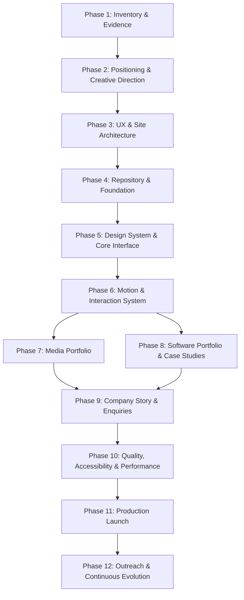

# Great Light Group — Portfolio Roadmap

> **Motto:** *In him we have light*  
> **Mission:** Deliver a world-class dual-discipline digital presence uniting **Technology & Software** and **Media & Creative**, communicating bespoke craftsmanship, intentional motion, confident typography, and engineered precision before visitors read the copy.

---

## 1. Core Principles & Architecture

### Distinct Disciplines, Unified Identity
- **Narrowed Scope:** Technology & Software and Media & Creative only. Science, agriculture, and general commerce are strictly out of scope for this flagship portfolio.
- **Craftsmanship First:** The initial viewport must establish visual direction, intentional motion, editorial typography, and polished interaction.
- **Content is King:** Animation reveals the quality of the work; it never competes with or obscures real websites, software architectures, photography, or cinematography.
- **Clear Visitor Fork:** Visitors can immediately choose their path:
  1. **Software & Engineering Showcase** (Live previews, interactive case studies, GitHub repositories, architecture breakdowns).
  2. **Media & Creative Showcase** (Cinematic video, editorial photography galleries, creative direction, booking routes).

### Technology Stack
| Layer | Technology | Role in Portfolio |
| :--- | :--- | :--- |
| **Framework** | Next.js (App Router) + TypeScript | Routing, reusable components, static & server rendering, metadata, SEO |
| **Styling** | Tailwind CSS | Consistent design tokens, responsive layouts, negative space, typography |
| **Choreographed Motion** | GSAP + ScrollTrigger | Hero sequence, pinned scenes, choreographed timeline reveals |
| **Smooth Scrolling** | Lenis *(Optional / Evaluated)* | Fluid scroll synchronized with GSAP ScrollTrigger |
| **Micro-Interactions** | Motion (`motion/react`) / Native CSS | Lightweight transitions, hover states, mobile drawers, modal dialogs |
| **Interactive UI** | React Bits *(Selective)* | Curated, audited components adapted strictly to brand tokens |
| **Iconography** | Lucide React | Crisp, consistent geometric line icons |
| **Deployment** | Vercel + GitHub | Continuous integration, preview deployments, milestone releases |

---

## 2. Motion Hierarchy & Safeguards

- **Level 1 — First Impression:** Composed hero reveal, controlled typographic sequencing, branded visual frame, immediate navigation clarity.
- **Level 2 — Exploration:** Scroll-triggered reveals, layered editorial imagery, responsive card perspective shifts, media-to-software discipline switcher.
- **Level 3 — Interaction Details:** Tactile button feedback, focus states, image zoom triggers, fluid gallery controls, interactive drawer physics.

### Technical Safeguards
- Full support for `prefers-reduced-motion` with static, accessible fallbacks.
- Comprehensive GSAP context cleanup (`ctx.revert()`) across React lifecycle transitions.
- Zero layout jank: GPU-accelerated transforms (`transform`, `opacity`) exclusively.
- Native mobile scroll optimization: Lenis evaluated and disabled on mobile if touch inertia degrades performance.

---

## 3. The 12-Phase Master Execution Plan

### Phase 1 — Inventory and Evidence (Current Phase)
- **Objective:** Catalog all software projects, repositories, live deployments, photography assets, video files, graphic designs, and client agreements.
- **Deliverables:** `docs/PORTFOLIO_INVENTORY.md`, structured `assets/` directories, verification of client permissions.
- **Completion Gate:** Best publishable projects and media assets identified, status verified, gaps documented.

### Phase 2 — Positioning and Creative Direction
- **Objective:** Establish the dual-discipline brand voice, narrative bridge, typographic hierarchy, colour token palette (Deep Forest Green, Warm Gold, Deep Ink, Fine Paper), and art direction.
- **Deliverables:** `docs/DESIGN_BRIEF.md`, design token specifications.
- **Completion Gate:** Approved visual concept, hero wire-composition, and agreed visitor fork strategy.

### Phase 3 — User Experience and Site Architecture
- **Objective:** Wireframe visitor journeys for software enquiries and media bookings. Map component inventory, page structures, navigation state machine, and mobile responsiveness.
- **Deliverables:** `docs/UX_AND_SITE_MAP.md`, wireframe schemas, component inventory.
- **Completion Gate:** Every route has a distinct purpose, seamless navigation between disciplines, zero dead ends.

### Phase 4 — Repository and Project Foundation
- **Objective:** Initialize the Next.js + TypeScript application, Tailwind CSS configuration, ESLint/Prettier rules, Git branch protections, and CI/CD preview pipelines.
- **Deliverables:** Clean, runnable application build; verified development environment.
- **Completion Gate:** `npm run build` succeeds cleanly; preview deployment live on Vercel.

### Phase 5 — Design System and Core Interface
- **Objective:** Code core reusable components: typographic scales, container grids, navigation bar, footer, discipline toggle, project cards, media frames, and enquiry buttons.
- **Deliverables:** Production-grade UI component library in `components/`.
- **Completion Gate:** Complete visual coherence and responsive integrity with animations completely disabled.

### Phase 6 — Motion and Interaction System
- **Objective:** Implement GSAP timelines, ScrollTrigger integrations, Lenis smooth scrolling (with sync and mobile guards), entrance reveals, and micro-interactions.
- **Deliverables:** `lib/motion/` hooks, animation timeline controllers, `prefers-reduced-motion` fallbacks.
- **Completion Gate:** 60fps performance across desktop and mobile; clean garbage collection and lifecycle teardown.

### Phase 7 — Media Portfolio
- **Objective:** Curate high-resolution photography, embedded/streamed video showcases, editorial grid layouts, lightbox viewers, and booking calls to action.
- **Deliverables:** `/media` showcase page, gallery components, responsive image optimization.
- **Completion Gate:** Flawless visual fidelity, fast LCP on mobile, instant media booking enquiry path.

### Phase 8 — Software Portfolio and Case Studies
- **Objective:** Build interactive software cards, architecture diagrams, live demo links, technical case studies (problem, architecture, role, decisions, trade-offs, results).
- **Deliverables:** `/software` showcase, case study template, interactive demo frames.
- **Completion Gate:** Verified engineering credibility featuring top projects (e.g. Baduwa, Elgyboat, 3 Swami Stars, LearnMate, Double-Entry Go).

### Phase 9 — Company Story and Enquiries
- **Objective:** Develop the "About Great Light Group" narrative, founder introduction, service matrix (12 core technology services + creative media services), contact forms, and pre-filled WhatsApp routing.
- **Deliverables:** `/about` and `/contact` sections, multi-channel enquiry handlers.
- **Completion Gate:** Working contact flows for both software clients and media clients without dead links.

### Phase 10 — Quality, Accessibility, and Performance
- **Objective:** Rigorous audit across Lighthouse (Performance, Accessibility, Best Practices, SEO), WCAG 2.1 AA compliance, keyboard navigation, screen reader testing, and cross-browser verification.
- **Deliverables:** `docs/QA_CHECKLIST.md`, resolved audit log.
- **Completion Gate:** Lighthouse score 95+ across all metrics; full keyboard accessibility; verified reduced-motion compliance.

### Phase 11 — Production Launch
- **Objective:** Domain connection (`greatlightgroup.com` or designated domain), DNS configuration, production Vercel deployment, OpenGraph social cards, robots.txt, sitemap.xml.
- **Deliverables:** Public production deployment, release tag `v1.0.0`.
- **Completion Gate:** Production URL live, SSL active, social share cards rendering correctly, zero runtime errors.

### Phase 12 — Outreach and Continuous Improvement
- **Objective:** Generate tailored portfolio packages for prospective clients and partners, configure analytics, track inbound conversions, and maintain a structured update cycle.
- **Deliverables:** `docs/PORTFOLIO_CHANGELOG.md`, client outreach decks.
- **Completion Gate:** Portfolio actively driving proposals and client enquiries with documented iteration rhythm.
