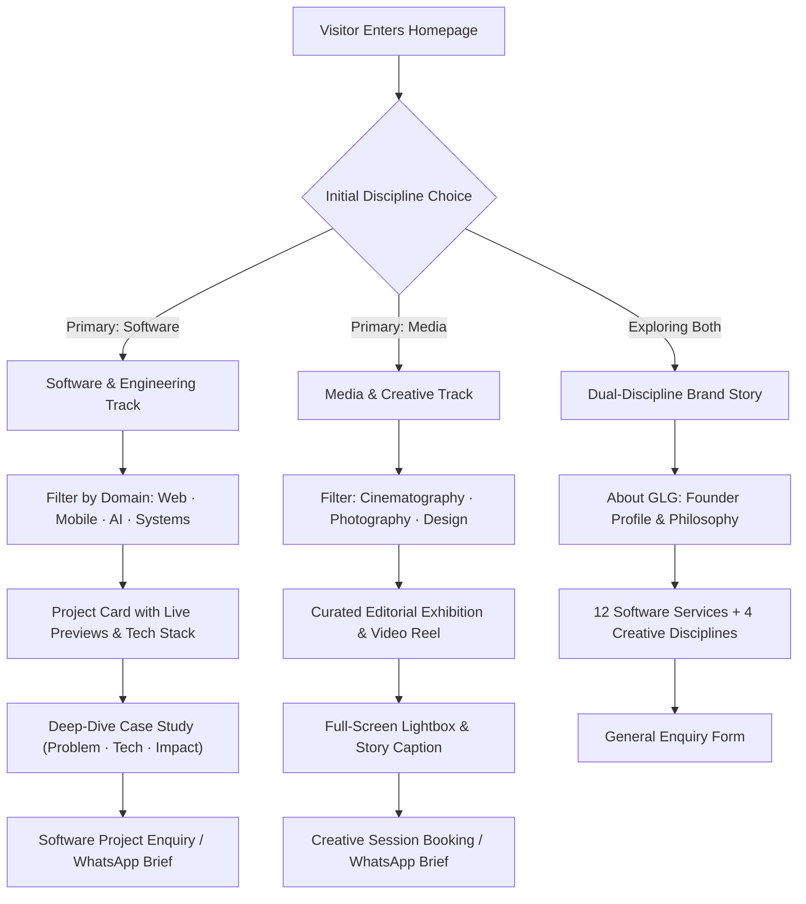

# Great Light Group — UX Architecture & Site Map

> **Brand:** Great Light Group  
> **Motto:** *In him we have light*  
> **Phase:** Phase 3 — User Experience & Site Architecture  
> **Document Role:** Definitive blueprint for visitor journeys, URL routing, page wireframes, and component inventory.

---

## 1. Visitor Personas & Journey Mapping



### Persona A: Tech Client / Engineering Recruiter
- **Intent:** Validate technical competence, architecture depth, delivery speed, and code quality.
- **Key Touchpoints:**
  - Fast-loading live deployment links (`baduwa.vercel.app`, `elgyboat.vercel.app`, `nutritionguide.xyz`).
  - Public GitHub repository links with clean commit history.
  - Transparent technology tags (`Go 1.24`, `Next.js 15`, `Tailwind CSS`, `Prisma`, `PostgreSQL`).
  - Pre-filled WhatsApp consultation or direct quotation request.

### Persona B: Creative / Event / Commercial Media Client
- **Intent:** Evaluate aesthetic taste, visual storytelling, lighting craftsmanship, and production quality.
- **Key Touchpoints:**
  - High-framerate video reels (`potone.mp4`, `silent.mp4`) with instant play/pause.
  - Large-scale editorial photography galleries with responsive zoom and rich tone.
  - Typographic poster designs showcasing graphic design precision.
  - Frictionless booking avenue with clear inquiry categories.

### Persona C: Corporate Partner / High-Value Enterprise
- **Intent:** Confirm corporate legitimacy, dual-discipline synergy, and leadership.
- **Key Touchpoints:**
  - Authentic Great Light Group logo and founder profile (`assets/brand/profile.jpeg`).
  - Rigorous 12-service software matrix and creative capabilities.
  - Clear motto and values: "In him we have light."

---

## 2. Information Architecture & Sitemap

```
├── / (Homepage)
│   ├── [1] Branded Navigation Header (Logo + Discipline Fork + Mobile Menu)
│   ├── [2] Hero Section (Editorial Headline + Discipline Path Switcher)
│   ├── [3] Software Showcase Section (Top 4 Featured Engineering Projects)
│   ├── [4] Media Showcase Section (Video Reel + Editorial Photography + Posters)
│   ├── [5] Dual Services Matrix (12 Software Services + Creative Disciplines)
│   ├── [6] Company Story & Founder Profile (Philosophy, Leadership, Craftsmanship)
│   ├── [7] Integrated Enquiry & WhatsApp Hub (Dual Contact Pathways)
│   └── [8] Colophon & Footer
├── /software (Dedicated Software Portfolio)
│   ├── Filterable Project Grid (Web, Mobile, Backend, AI/Automation)
│   ├── Interactive Live Preview Modals
│   └── Deep-Dive Case Study Pages (/software/[slug])
├── /media (Dedicated Media & Creative Portfolio)
│   ├── Cinematography Showcase (Optimized HTML5 Video & Stream Embeds)
│   ├── Editorial Photography Galleries (with Lightbox Modal)
│   └── Graphic Design & Poster Studies
├── /about (Brand Heritage, Values & Founder Profile)
└── /contact (Direct Booking & Project Estimation)
```

---

## 3. Page Wireframe Blueprints

### Wireframe 1: Homepage (`/`)

```
+--------------------------------------------------------------------------+
|  [LOGO] Great Light Group    [Software | Media]   [About]   [Enquire CTA]|
+--------------------------------------------------------------------------+
|                                                                          |
|  EYEBROW: GREAT LIGHT GROUP · DUAL-DISCIPLINE STUDIO                     |
|  HERO TITLE: Two Disciplines. One Considered Standard.                   |
|  SUBTITLE: Engineered software precision united with cinematic media.     |
|                                                                          |
|  [ Explore Software Projects -> ]    [ View Creative Media -> ]          |
|                                                                          |
|  +--------------------------------------------------------------------+  |
|  | HERO AMBIENT REEL / INTERACTIVE DISCIPLINE SPLIT SCREEN PREVIEW   |  |
|  +--------------------------------------------------------------------+  |
+--------------------------------------------------------------------------+
|                                                                          |
|  SECTION: SOFTWARE & ENGINEERING (Featured 4)                            |
|  [All] [Full-Stack Apps] [AI & Automation] [Backend Systems]            |
|                                                                          |
|  +-------------------------+  +-------------------------+                |
|  | Baduwa Locs & Naturals  |  | Elgyboat Enterprise     |                |
|  | Next.js 15 · Framer     |  | Next.js 14 · Quote Cart |                |
|  | [Live Demo] [Case Study]|  | [Live Demo] [Case Study]|                |
|  +-------------------------+  +-------------------------+                |
|  +-------------------------+  +-------------------------+                |
|  | LearnMate AI Study App  |  | Double-Entry Go Ledger  |                |
|  | Next.js 16 · @xyflow    |  | Go 1.24 · PostgreSQL    |                |
|  | [GitHub] [Architecture] |  | [GitHub] [CI Pipeline]  |                |
|  +-------------------------+  +-------------------------+                |
+--------------------------------------------------------------------------+
|                                                                          |
|  SECTION: MEDIA & CREATIVE EXHIBITION                                    |
|  [Cinematography] [Editorial Photography] [Graphic Typography]           |
|                                                                          |
|  +--------------------------------------------------------------------+  |
|  | FEATURED VIDEO: Cinematic Motion Reel (potone.mp4 / silent.mp4)   |  |
|  +--------------------------------------------------------------------+  |
|                                                                          |
|  +-------------------+  +-------------------+  +--------------------+    |
|  | Baduwa Photo 01   |  | Baduwa Photo 02   |  | Editorial Poster   |    |
|  | Editorial Portrait|  | Texture & Craft   |  | "MAKE IT MATTER"   |    |
|  +-------------------+  +-------------------+  +--------------------+    |
+--------------------------------------------------------------------------+
|                                                                          |
|  SECTION: CORE SERVICES MATRIX                                           |
|  12 Software Offerings              4 Creative Offerings                 |
|  - Application Development          - Cinematography & Video             |
|  - Mobile App Development           - Editorial Photography              |
|  - Software Consulting              - Video Editing & Post               |
|  - Business Web Development         - Brand & Graphic Design             |
|  [ ... 8 more ]                                                          |
+--------------------------------------------------------------------------+
|                                                                          |
|  SECTION: LEADERSHIP & ETHOS                                             |
|  +-------------------+  "In him we have light."                          |
|  | Founder Portrait  |  Story of craftsmanship, engineering standards,   |
|  | [profile.jpeg]    |  and creative passion.                            |
|  +-------------------+                                                   |
+--------------------------------------------------------------------------+
|                                                                          |
|  SECTION: PROJECT ENQUIRY & CONTACT                                      |
|  [ Select Path: Software Project  |  Creative Media Booking ]            |
|  Name: [            ]   Email: [            ]                            |
|  Project Scope / Budget: [                   ]                           |
|  [ Send Enquiry ]   OR   [ Start Instant WhatsApp Chat -> ]              |
+--------------------------------------------------------------------------+
|  FOOTER: Copyright (c) Great Light Group · greatlightgroup247@gmail.com   |
+--------------------------------------------------------------------------+
```

---

## 4. Reusable Component Inventory

### A. Navigation & Shell
- `Navbar`: Sticky blurred backdrop (`backdrop-blur-md`), brand mark, discipline indicator, mobile burger menu.
- `DisciplineSwitch`: Animated segmented control switching focus between Software and Media.
- `MobileActionBar`: Sticky bottom bar on mobile with quick actions (Call, WhatsApp, Enquire).
- `Footer`: Clean editorial footer with social links, motto, email, copyright, and back-to-top button.

### B. Software UI Components
- `ProjectCard`: Responsive card featuring live preview image, tech badges, problem summary, and action links.
- `TechBadge`: Geometric monospace pill styling (`bg-glg-green/10 text-glg-green-light border-glg-green/20`).
- `LivePreviewModal`: Responsive iframe viewer allowing visitors to test live sites inside the portfolio.
- `ArchitectureBlock`: Mermaid diagram viewer or visual schema block highlighting system design.

### C. Media UI Components
- `CinematicPlayer`: HTML5 video player with custom ambient frame, hover controls, play/pause state.
- `EditorialGallery`: Asymmetrical CSS grid for high-resolution photography.
- `MediaLightbox`: Accessible modal overlay with keyboard navigation (`Esc`, `ArrowLeft`, `ArrowRight`).
- `PosterFrame`: Typographic display container with rich brand colors and custom layout.

### D. Form & Conversion Components
- `EnquiryForm`: Client-side validated form with field status, error states, and submission feedback.
- `WhatsAppCTA`: Dynamic generator constructing URL-encoded WhatsApp messages based on selected services.
- `StatusBadge`: Indicates project lifecycle (`Live`, `Completed`, `Prototype`, `In Development`).

---

## 5. Mobile & Responsive Layout Strategy

- **Breakpoints:**
  - `sm`: 640px (large phones / small tablets)
  - `md`: 768px (tablets in portrait)
  - `lg`: 1024px (laptops and tablets in landscape)
  - `xl`: 1280px (standard desktop displays)
  - `2xl`: 1536px (wide cinema displays)
- **Touch Targets:** All interactive buttons and pills meet minimum 48x48px touch bounding box.
- **Fluid Typography:** CSS `clamp()` functions eliminate awkward font size jumps across viewports.
- **Performance Optimization:** Images served via Next.js responsive image sets (`sizes="(max-width: 768px) 100vw, (max-width: 1200px) 50vw, 33vw"`).
